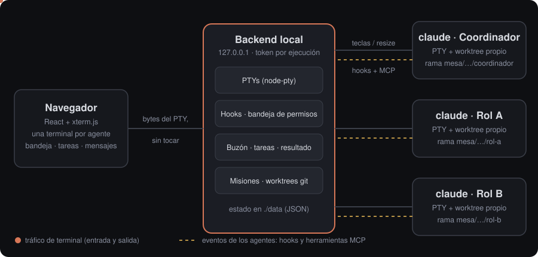
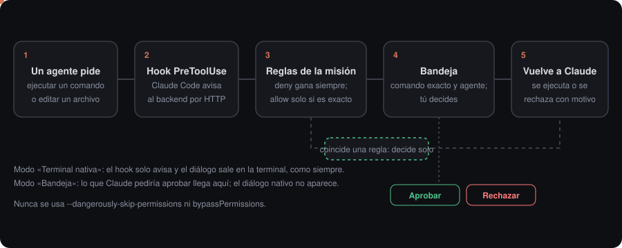
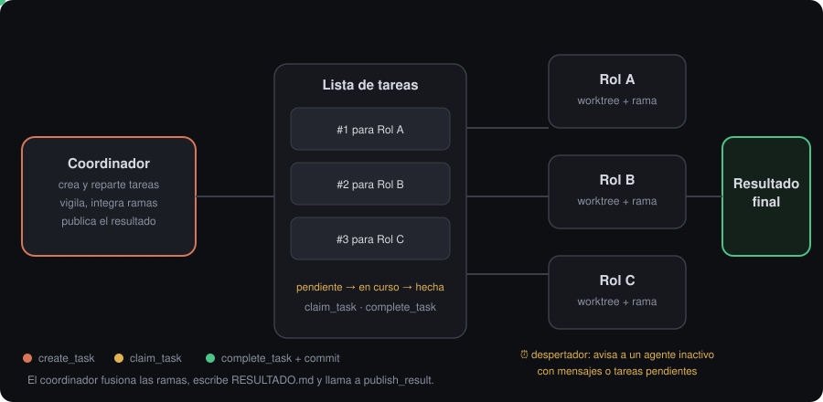

# Mesa de Agentes

App web **local** para orquestar varias sesiones reales de [Claude Code](https://code.claude.com) (`claude`) a la vez: una terminal por agente en una sola pantalla, un organizador de misiones y, si quieres, una bandeja donde apruebas tú los permisos.

Cada terminal es el `claude` de siempre (xterm.js sobre un PTY, sin filtrar ni reescribir su salida), así que **sus restricciones y su interfaz no cambian**. Mesa de Agentes solo lo rodea: lanza los agentes, les da un git worktree a cada uno, les pasa su rol y los hace hablar entre sí.

> Nunca usa `--dangerously-skip-permissions` ni `bypassPermissions`.

## Cómo funciona

### 1. Arquitectura



- El **navegador** muestra una terminal xterm.js por agente. Los bytes del PTY pasan tal cual; si recargas la página, las terminales siguen vivas y se reconectan con su historial.
- El **backend local** (Fastify + ws + node-pty, solo en `127.0.0.1`) crea los PTYs, los git worktrees, recibe los hooks de Claude Code y guarda el estado en `./data` (JSON).
- Cada **agente** es un `claude` real con su propio worktree y rama (`mesa/<misión>/<rol>`), de modo que nunca se pisan archivos.

### 2. Aprobaciones de permisos



Cada misión elige entre dos modos:

| Modo | Qué pasa |
| --- | --- |
| **Terminal nativa** (por defecto) | Los hooks solo avisan. El diálogo de permisos sale en la terminal como siempre y se responde ahí. La barra lateral muestra «esperando aprobación en la terminal». |
| **Bandeja** | Lo que Claude pediría aprobar llega a la bandeja con el agente, la herramienta y el **comando o archivo exacto**. Pulsas Aprobar o Rechazar y la decisión vuelve a Claude. El diálogo nativo no aparece. |

Reglas allow/deny por misión y por rol, con la sintaxis de permisos de Claude Code (`Tool` o `Tool(especificador)`): `Bash(npm test)`, `Bash(git push *)`, `Edit(src/**)`. Se escriben en el `settings.local.json` de cada worktree (las aplica Claude) y el backend las evalúa también. **Deny gana siempre**, y una regla allow no se concede a comandos compuestos (`npm test && curl …` va a la bandeja).

### 3. Una misión con coordinador



Al lanzar la misión, **cada agente arranca solo** con su prompt inicial; no tienes que escribirles nada.

1. El **coordinador** (el «cerebro») crea las tareas que falten con `create_task`, dirigidas a un rol, y avisa a los trabajadores.
2. Cada **trabajador** reclama las suyas con `claim_task`, trabaja en su rama, hace commit y llama a `complete_task` con el resultado.
3. El coordinador vigila, **integra las ramas**, escribe `RESULTADO.md` y llama a `publish_result`. Lo ves en la barra lateral como «Resultado final».

Claude Code trabaja por turnos: un agente que terminó no se entera de mensajes nuevos. Por eso hay un **despertador**: si un agente lleva unos segundos inactivo y tiene mensajes o tareas pendientes, el backend le escribe una línea corta. Solo actúa en misiones con coordinador, espera 30 s entre avisos y no mira la pantalla.

## Instalar y correr

Requisitos: Node 20+, `git` y `claude` instalado con la sesión iniciada (`claude` → `/login`).

```bash
git clone https://github.com/emilianocros27-bit/agent-table.git
cd agent-table
npm install
npm run build
```

Necesitas un **repo git con al menos un commit** sobre el que trabajarán los agentes. Si no tienes uno pequeño para probar:

```bash
mkdir -p ~/Desktop/demo-mesa && cd ~/Desktop/demo-mesa
git init -b main && echo "# demo" > README.md && git add . && git commit -m inicial
```

Confía en esa carpeta **una vez** (así las terminales no preguntan por cada worktree):

```bash
cd ~/Desktop/demo-mesa && claude      # acepta «Yes, I trust this folder» y escribe /exit
```

Arranca la app apuntando a tu repo:

```bash
cd agent-table
npm start -- --project ~/Desktop/demo-mesa
```

Imprime una línea como:

```
Mesa de Agentes: http://127.0.0.1:52341/?token=3f9a…
```

**Copia la línea completa, empezando en `http`,** y ábrela en el navegador. El puerto y el token cambian en cada ejecución. Si abres la dirección sin el token verás una pantalla donde pegarlo.

Variables opcionales: `PORT`, `DATA_DIR` (por defecto `./data`), `CLAUDE_BIN`, `CLAUDE_ARGS` (por defecto `--permission-mode default`), `PLAN_MODEL` (por defecto `sonnet`).

## Cómo usarla

1. Pulsa **Nueva misión** y escribe la **meta**.
2. Opcional: **Proponer plan** pide a Claude (una llamada sin herramientas, con tope de coste) roles y tareas. Es solo una propuesta: lo editas todo antes de lanzar.
3. Elige el **modo**: *Terminal nativa* o *Bandeja de aprobaciones*.
4. Deja marcado **Coordinador** si quieres que alguien reparta tareas, vigile y entregue el resultado. Cuenta como un agente más.
5. Define los **roles**: nombre, instrucciones y, si quieres, reglas allow/deny propias.
6. Ajusta el **máximo de agentes** (4 por defecto). Cada agente es una sesión de Claude distinta: con N agentes el gasto de tokens se multiplica por N.
7. Opcional: «Aceptar ediciones automáticamente» lanza con `--permission-mode acceptEdits` (las ediciones no preguntan; Bash y lo demás sí).
8. Pulsa **Lanzar misión**. Verás las terminales en un grid (layouts 1/2/3/4, divisores arrastrables, maximizar) y en la barra lateral el estado de cada agente (*trabajando*, *esperando aprobación*, *inactivo*, *terminado*), las tareas y el feed de mensajes.
9. En modo bandeja, aprueba o rechaza lo que llegue al panel derecho.
10. **Detener misión** para los agentes; **Terminar misión** y **Limpiar worktrees…** al acabar. La limpieza nunca descarta cambios sin commitear sin que lo autorices, y las ramas con commits se conservan.

### Herramientas MCP de los agentes

Cada worktree registra el servidor MCP `mesa` (`.mcp.json`):

| Herramienta | Quién | Qué hace |
| --- | --- | --- |
| `send_message(to, texto)` | todos | Mensaje a otro agente por nombre o a «todos». |
| `read_inbox()` | todos | Lee y marca como leídos los mensajes recibidos. |
| `list_tasks()` | todos | Tareas de la misión, su estado, destinatario y responsable. |
| `claim_task(id)` | todos | Toma una tarea pendiente (exclusivo; si va dirigida, solo su destinatario). |
| `complete_task(id, resultado)` | quien la tomó | La marca como hecha. |
| `post_status(texto)` | todos | Una línea de estado visible en la UI. |
| `create_task(titulo, para?)` | coordinador | Crea una tarea. |
| `publish_result(texto)` | coordinador | Publica el resultado final. |

## Seguridad

- Escucha solo en `127.0.0.1`; token aleatorio por ejecución; se validan `Host` y `Origin` en HTTP y WebSocket.
- Los PTYs solo se crean dentro de la carpeta del proyecto elegida.
- Cada agente recibe un token propio, distinto del de la UI, que solo sirve para sus hooks y herramientas: no abre la API, no decide aprobaciones y no puede actuar como otro agente. Ningún secreto se escribe en `settings.local.json` ni en `.mcp.json` (van por variable de entorno).
- Los diálogos de confianza de carpeta y de servidores MCP los responde Claude Code en la terminal; la app no los automatiza.

## Pruebas

```bash
npm test            # 43 pruebas con un `claude` falso (scripts/fake-claude.mjs): no gastan tokens
npm run typecheck
```

El `claude` falso simula la TUI, el diálogo de permisos y los hooks HTTP de Claude Code. Las pruebas levantan servidores y repos git reales y tardan unos minutos.

## Estructura

```
server/     backend: PTYs, misiones y worktrees, reglas, aprobaciones, hub (buzón y tareas), plan, despertador
web/src/    frontend React + xterm.js
scripts/    servidor MCP (mesa-mcp.mjs) y claude falso (fake-claude.mjs)
docs/       diagramas animados (SVG)
test/       pruebas
spike/      experimento inicial de hooks
```

## Problemas frecuentes

- **«Token inválido o caducado»**: el token cambia en cada `npm start`. Copia la línea completa nueva, empezando en `http`, y pégala en el navegador o en la pantalla del token.
- **Chrome abre `file:///…` o busca en Google**: faltó el `http://` al copiar. Pega la línea completa.
- **«La carpeta del proyecto no existe»**: usa una ruta real a un repo git con al menos un commit.
- **Cada terminal pregunta si confías en la carpeta**: abre `claude` una vez en la carpeta del proyecto y acepta la confianza.
- **La terminal de un agente pide login**: ejecuta `claude` en una terminal normal y haz `/login`.

## Límites conocidos

- Una misión detenida no se relanza; se crea otra. Si reinicias el servidor, los agentes mueren y las misiones quedan como «detenidas».
- Los permisos siguen pidiéndose: eso es Claude Code protegiéndote. Usa la bandeja y reglas allow para reducir las peticiones.
- La bandeja decide por una aproximación de «Claude pediría permiso» (herramientas que piden permiso en modo `default`, salvo comandos de solo lectura conocidos); algo no clasificado puede mostrar el diálogo nativo.
- Con coordinador, el flujo completo hasta el resultado final está cubierto por pruebas automáticas; con agentes reales se comprobó el reparto, el despertador y el trabajo en worktrees, pero depende de que apruebes los permisos que lleguen.
